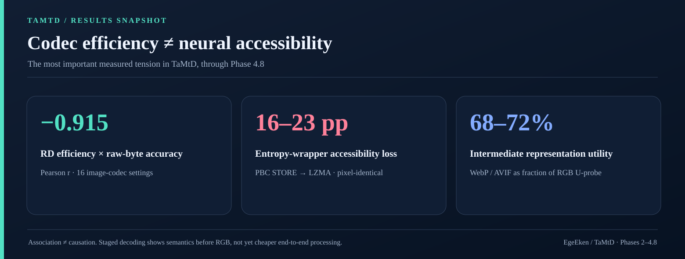
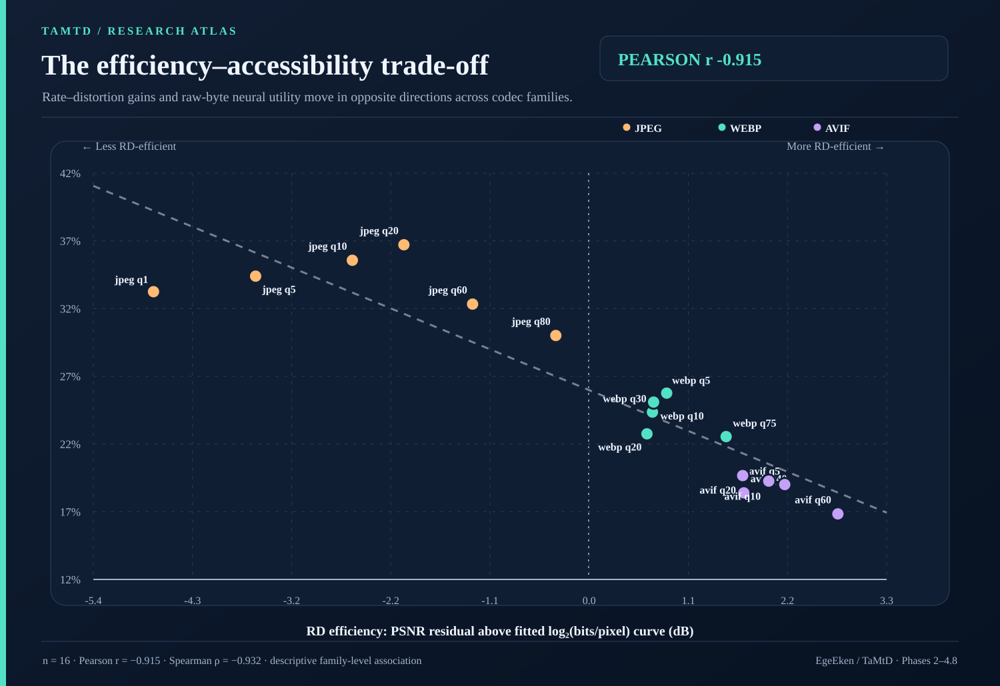
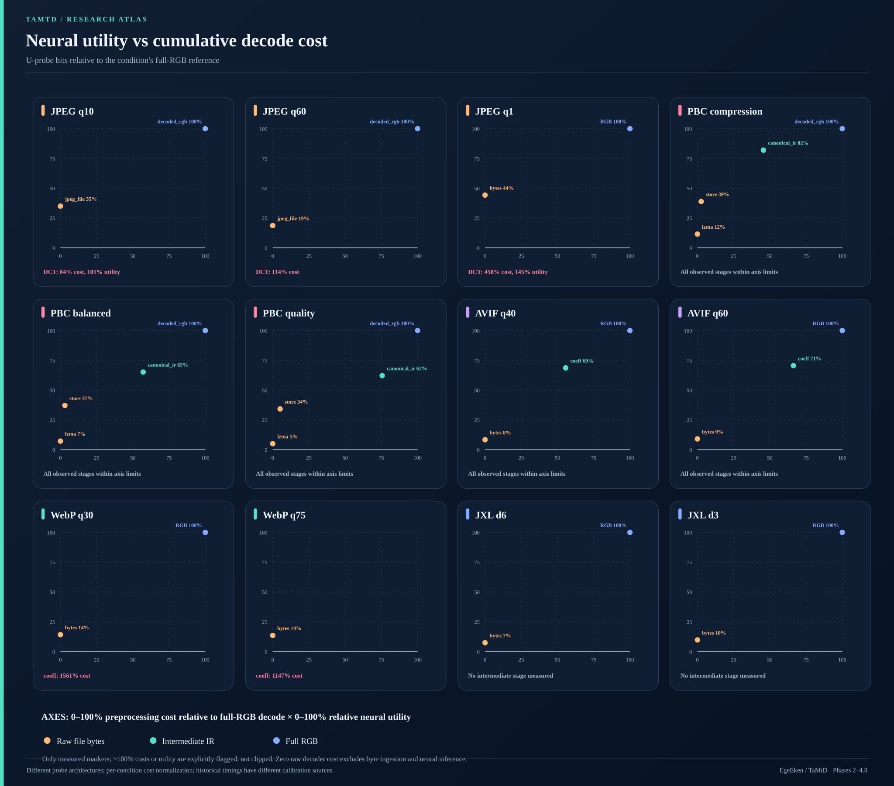

# TaMtD — Teach a Model to Decode

**Measuring neural semantic accessibility versus cumulative preprocessing cost across image and video codecs.**

TaMtD studies the representations between entropy-coded file bytes and fully decoded RGB frames. The goal is not to show that neural networks can learn to decode; it is to establish **which codec stages expose usable task information, at what cost, and whether any compressed-domain approach is competitive with conventional decoding and vision encoding**.

## Main image-track findings (through Phase 4.8)

- **RD efficiency vs raw accessibility:** Across 16 JPEG/WebP/AVIF operating points, a pooled PSNR-over-log-rate RD-efficiency residual correlates with common seed-42 raw-byte classification at **Pearson r = −0.915**. Much of the relationship is **between codec families**; it is not a universal within-codec law.

- **Identical pixels, different coding:** PBC STORE vs LZMA achieves **25–39% smaller streams** with the *same decoded pixels* but **16–23 percentage points lower** three-seed mean raw-byte accuracy under LZMA.

- **Comparable decoded utility, unequal byte utility:** Near 0.6 bpp, JPEG q20, WebP q30 and AVIF q40 retain ~81% decoded RGB accuracy, but raw byte accuracy is **36.71%, 24.36% and 18.39%**.

- **Structured codec features have utility, but extraction costs matter:** The WebP/AVIF intermediate classifiers attain ~68–72% of full RGB U-probe utility, yet AVIF's pre-reconstruction extraction + adapter already costs **95–96% of full YUV decode**, and the measured WebP adapter is slower than full RGB decode. **No end-to-end advantage has been established.**

## Research figures

**Relative U-probe accessibility versus cumulative decoder cost** — both axes are 0–100%, independently normalized per codec setting. Off-scale observations are annotated, not discarded.

**[Full research synthesis: all numerical tables, stage charts, controls, limitations and future program](docs/research/ta-mtd-research-report.md)**

Additional figures: [relative accuracy frontier](docs/research/figures/relative-accuracy-vs-decode-cost.svg) · [PBC entropy-wrapper control](docs/research/figures/pbc-entropy-wrapper-control.svg) · [matched codecs](docs/research/figures/matched-codec-accessibility.svg) · [raw/RGB bitrate sweep](docs/research/figures/bitrate-vs-raw-and-rgb.svg) · [decode bottlenecks](docs/research/figures/decoder-bottlenecks.svg).

## Evidence base

The 256×256 Imagenette experiment uses **13,394 aligned images** (8,522 train, 947 validation, 3,925 test) with JPEG, WebP, AVIF, JPEG XL and PBC; phases through 4.8 instrument raw, structured and decoded representations. The byte-model comparison holds the ByteStreamCNN architecture/seed fixed, but **different architectures** are used for structured and RGB stages. Reported stage costs come from different historical calibration groups, and 0% for raw bytes means zero *decoder operation*, not zero input ingestion/inference. Results are empirical properties of the tested probes and implementations, not a proven universal compression law.

Original artifacts: [Phase 4.5B](results/Phase%204.5B%20Analysis/), [Phase 4.7](results/Phase%204.7%20Standard%20Codec%20Stages/), [Phase 4.8](results/Phase%204.8%20Extreme%20Compression/). The report links the complete CSV/JSON evidence.

## Planned work

**Next:** H.264 video V0/V1 feasibility. Build a small fixed motion-sensitive video benchmark; validate GOP/frame/timestamp and decoder output alignment; measure demux, NAL parsing, accessible motion/residual structure, YUV and RGB extraction **on the same streams**. Decoder-exported motion vectors are not assumed to be available before reconstruction.

**Then:** train compact motion/syntax/keyframe probes with matched decoded-frame baselines; optimize any promising extraction path; measure **end-to-end** accuracy, latency, throughput, host/GPU memory and token budget before considering a pinned Qwen VLM benchmark or structured-input student.

Detailed criteria: [future work in the synthesis](docs/research/ta-mtd-research-report.md#8-planned-future-work) · [video track research plan](docs/Video%20Track%20Research%20Plan.md).

**Current status:** image results consolidated through Phase 4.8. Video stage feasibility next.
