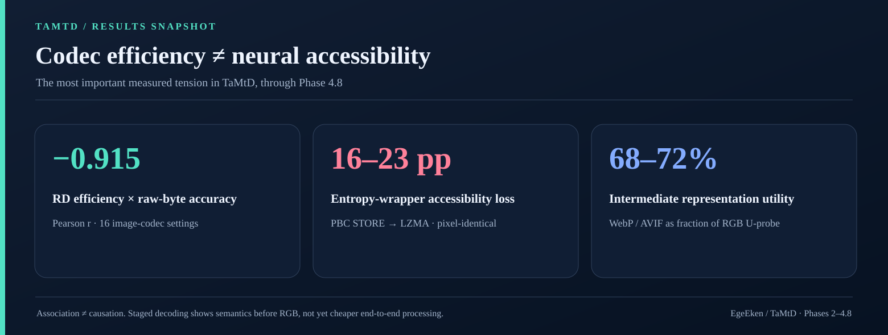
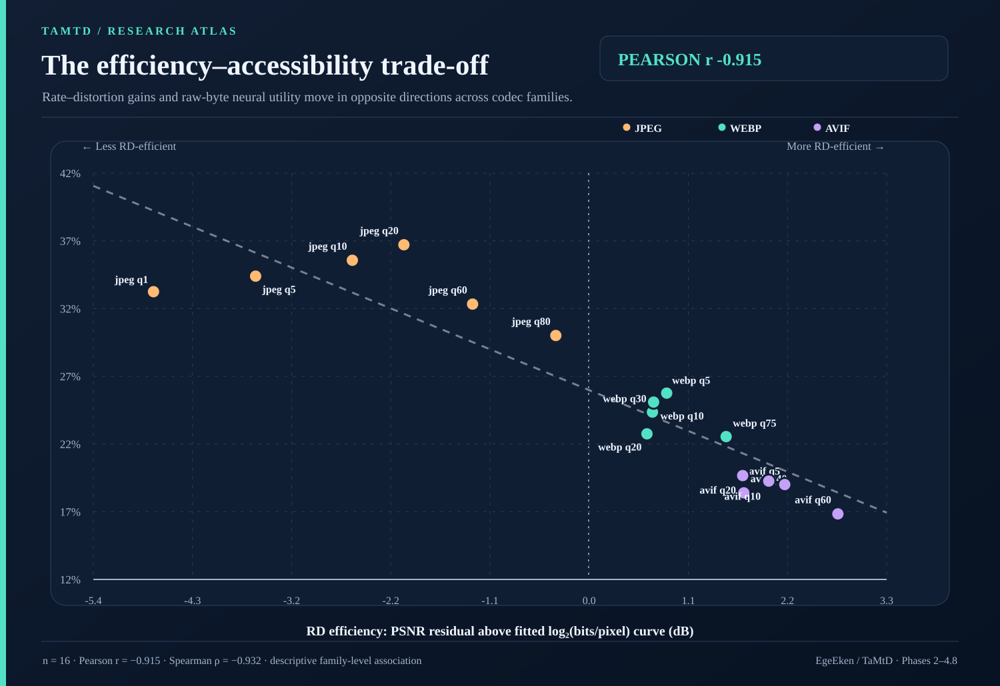
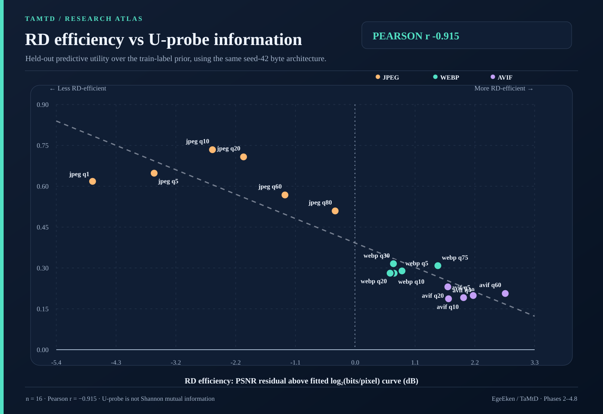
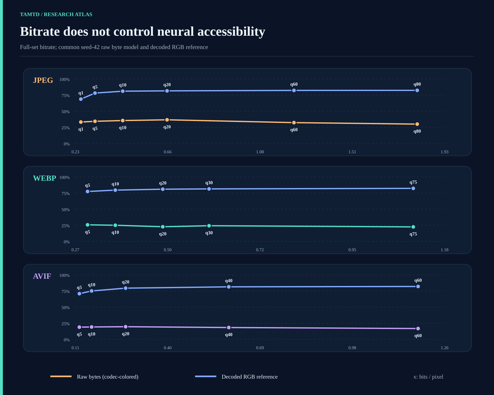
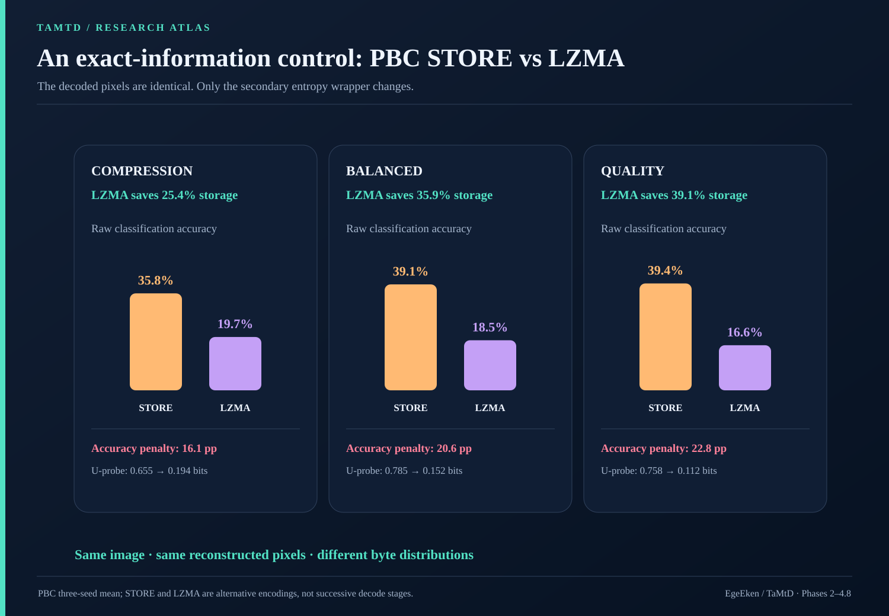
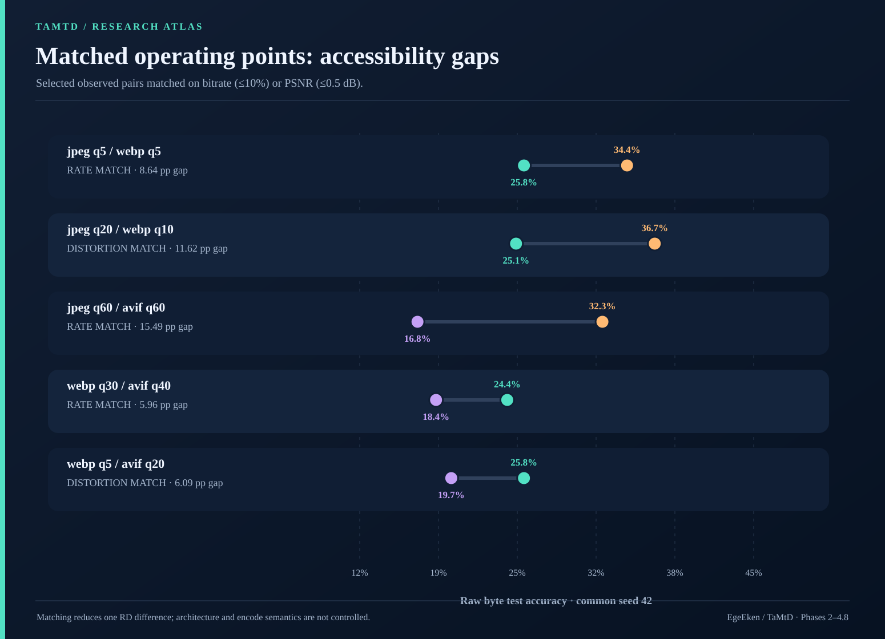
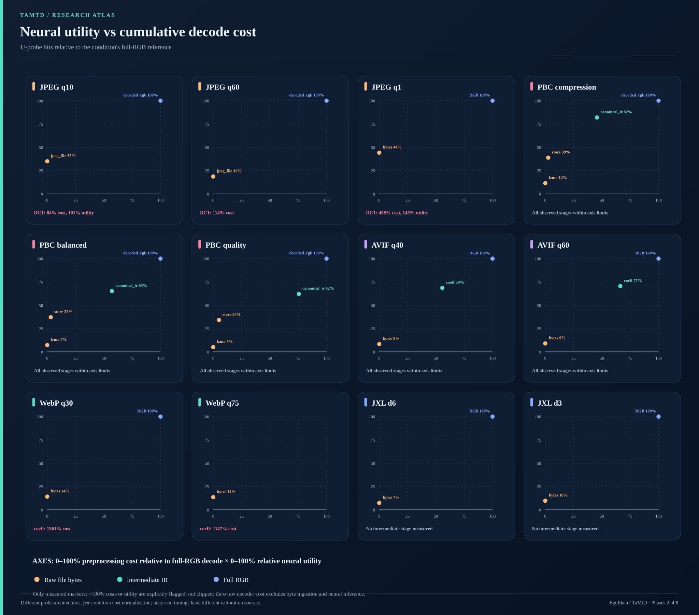
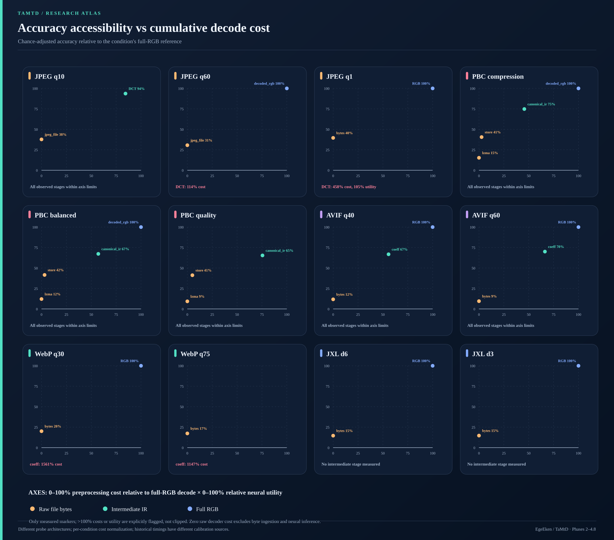
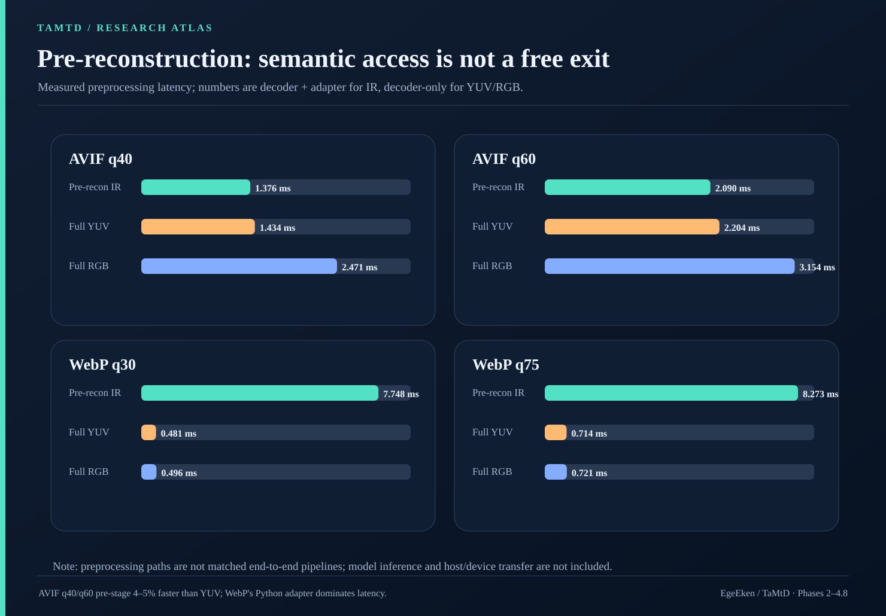

# TaMtD · Research findings through Phase 4.8

> **Source freeze:** [`46308b2`](https://github.com/EgeEken/TaMtD/commit/46308b2a6a4a698ea679f84fa1bb6435a088f4d4); synthesis dated 2026-11-12. This document recomputes descriptive statistics from existing committed measurements; it contains no newly trained models, decoder timings or fabricated intermediate points.

## Core question and scientific findings

For media codec representations exposed at different decoding stages, **how much task-relevant neural utility is available, and how much preprocessing is required to access it?** We separately ask whether more rate–distortion-efficient coding tends to make the compressed bytes less accessible to a fixed raw-byte neural architecture.

**Finding A — A strong *pooled*, primarily between-family efficiency/accessibility trade-off.** On 16 JPEG, WebP and AVIF settings, the PSNR-above-log-rate RD residual correlates with raw-byte test accuracy at **Pearson r = -0.915** and raw U-probe utility at **r = -0.915**. Including JXL leaves a strong descriptive association. Family-demeaning weakens it substantially, so we have not established a universal within-codec law.

**Finding B — A controlled coding-layer penalty.** PBC STORE and LZMA versions are pixel-identical at every preset, while LZMA compresses 25–39% smaller and reduces raw model accuracy by 16–23 percentage points. This isolates the accessibility consequence of changing encoded byte organization while keeping decoded visual content fixed.

**Finding C — Similar RD and decoded-RGB utility does not mean similar raw accessibility.** WebP q5 and AVIF q20 have similar measured bitrate and PSNR yet differ by 6.09 percentage points in byte accuracy. JPEG q20, WebP q30 and AVIF q40 give ~81% decoded RGB classification near 0.6 bpp, while raw byte accuracy is 36.71%, 24.36% and 18.39%.

**Finding D — Intermediate codec representations recover useful structure, but may erase any early-exit savings.** AVIF pre-reconstruction coefficients expose ~70–72% of the full RGB reference's U-probe utility, but extracting them plus adaptation already costs ~95–96% of native YUV decoding. WebP's current adapter makes its intermediate path 11–16× slower than full RGB decoding.

**Finding E — The core systems question remains open.** None of these stage evaluations demonstrates an end-to-end performance advantage over full RGB decoding and neural inference. Different trained probes, CPU decode paths, input processing and device transfer prevent that inference.

## Measurement and definitions

The prepared **256×256 Imagenette** split includes **13,394 images** (8,522 train / 947 validation / 3,925 test), 10 classes, and aligned source images across codecs. Phase 4.8 added JPEG q1/q5, WebP q5/q10/q20 and AVIF q5/q10/q20; all eight new stream caches contain 13,394 samples and were tested with **zero byte-model truncation**. New raw training used seed 42; some historical JPEG/PBC raw results have three seeds, other modern-codec raw results one seed. Decoded RGB means use three previously trained original-RGB reference checkpoints. No RGB classifier was retrained separately for each quality setting.

The common raw benchmark is **ByteStreamCNN**. The staged feature probes use JPEGDCTNet, PBCInstructionNet, BlockStageTransformer, and a separate RGBResNet18. Different accuracies are therefore **representation-plus-probe outcomes**, not controlled comparisons of intrinsic information.

`U_probe_bits = (CE(training-label prior) − CE(model)) / ln(2)`, measured on test predictions. It is a predictive-probe diagnostic **not Shannon mutual information**. The relative U chart divides by the same condition's full RGB U. Relative accuracy is chance-corrected: `100 × (accuracy − 0.10) / (RGB accuracy − 0.10)`. Relative decoder cost is `100 × measured cumulative preprocessing milliseconds / full-RGB decode milliseconds`, **within each timing source and codec condition**.

## 1. RD efficiency versus byte accessibility

For the 16 JPEG/WebP/AVIF points, fit `PSNR_dB = 32.9706 + 3.5747 × log2(bpp)`. **RD efficiency** in these figures is the *PSNR residual* above this pooled fitted curve. It is a descriptive relative efficiency score, **not** an intrinsic algorithmic codec efficiency or a causal treatment variable.

| Sensitivity analysis | r vs raw accuracy | r vs raw U |

|---|---:|---:|

| Linear PSNR residual, 16 | -0.915 | -0.915 |
| Linear PSNR residual, 18 incl. JXL | -0.880 | -0.862 |
| Quadratic log-rate PSNR residual, 16 | -0.881 | -0.894 |
| Linear log-rate SSIM residual, 16 | -0.736 | -0.776 |
| Linear residual after removing family means, 16 | -0.435 | -0.399 |
| Quadratic residual after removing family means, 16 | -0.122 | -0.021 |

The pooled inverse association survives alternative curve choices and two JXL points, but its **within-family** component is much weaker and changes with the RD reference model. The 16 measurements belong to only **three codec families** and are not 16 independent codec designs. There is no justification for extrapolating a universal negative RD/accessibility law across all entropy coders or neural architectures.

Earlier Phase 4.5B fit a log-bitrate + PSNR model to 14 PBC/JPEG/WebP/AVIF/JXL stream-form points: raw-accuracy in-sample R² was **0.332**, versus **0.857** after adding codec family (leave-one-out RMSE 0.0904 → 0.0556). This is an exploratory, small-n result with duplicated PBC decoded content and correlated predictors. The [original regression artifacts](../../results/Phase%204.5B%20Analysis/rd_accessibility_model.json) document the fit.

### All measured JPEG, WebP, AVIF and JXL operating points

| Condition | bpp | PSNR (dB) | SSIM | Raw acc. (seed 42) | Raw U (bits) | RGB acc. (3-seed mean) | Raw seeds |

|---|---:|---:|---:|---:|---:|---:|---:|

| `jpeg_q1` | 0.254 | 21.17 | 0.569 | 33.25% | 0.618 | 67.34% | 1 |
| `jpeg_q5` | 0.320 | 23.46 | 0.671 | 34.39% | 0.648 | 77.76% | 1 |
| `jpeg_q10` | 0.448 | 26.25 | 0.774 | 35.57% | 0.734 | 80.69% | 3 |
| `jpeg_q20` | 0.652 | 28.75 | 0.850 | 36.71% | 0.708 | 81.61% | 1 |
| `jpeg_q60` | 1.238 | 32.81 | 0.928 | 32.33% | 0.568 | 81.96% | 3 |
| `jpeg_q80` | 1.808 | 35.67 | 0.957 | 30.01% | 0.509 | 81.99% | 1 |
| `webp_q5` | 0.299 | 27.60 | 0.805 | 25.76% | 0.289 | 78.28% | 1 |
| `webp_q10` | 0.367 | 28.52 | 0.836 | 25.10% | 0.281 | 79.61% | 1 |
| `webp_q20` | 0.484 | 29.86 | 0.873 | 22.75% | 0.281 | 80.76% | 1 |
| `webp_q30` | 0.598 | 31.01 | 0.897 | 24.36% | 0.316 | 81.28% | 1 |
| `webp_q75` | 1.099 | 34.96 | 0.950 | 22.55% | 0.308 | 81.89% | 1 |
| `avif_q5` | 0.125 | 24.37 | 0.693 | 19.01% | 0.199 | 72.49% | 1 |
| `avif_q10` | 0.163 | 25.57 | 0.739 | 19.26% | 0.191 | 75.93% | 1 |
| `avif_q20` | 0.269 | 27.88 | 0.818 | 19.67% | 0.231 | 79.75% | 1 |
| `avif_q40` | 0.590 | 31.95 | 0.911 | 18.39% | 0.187 | 81.38% | 1 |
| `avif_q60` | 1.181 | 36.55 | 0.962 | 16.84% | 0.206 | 81.91% | 1 |
| `jxl_d6` | 0.569 | 29.85 | 0.866 | 20.38% | 0.163 | NaN% | 1 |
| `jxl_d3` | 0.966 | 32.96 | 0.926 | 20.59% | 0.221 | NaN% | 1 |

Raw accuracy and U in this table are **seed-42 values**, even where three raw seeds exist. See [Phase 4.8 operating points](../../results/Phase%204.8%20Extreme%20Compression/operating_point_summary.csv), [Phase 4.5B JXL/PBC points](../../results/Phase%204.5B%20Analysis/raw_byte_accessibility_table.csv) and [the derived residual table](data/rd-efficiency-raw-accessibility.csv). Note that RGB accuracy improves systematically with quality within each family, while raw accuracy and U need not move together.

### Same-image paired quality comparisons

Each contrast evaluates the **same 3,925 test image IDs** with **independently trained, seed-42** models. Positive Δ favors the lower-quality setting. The 95% image bootstrap holds fitted checkpoints fixed and **does not estimate seed uncertainty**; McNemar p-values are exploratory and unadjusted for 13 comparisons.

| Lower → higher quality | Δ raw accuracy (lower minus higher) | Paired 95% bootstrap CI | Exact p |

|---|---:|---:|---:|

| `jpeg_q1` → `jpeg_q5` | -1.15 pp | [-2.90, 0.51] pp | 0.1903 |
| `jpeg_q5` → `jpeg_q10` | -1.17 pp | [-2.70, 0.38] pp | 0.1592 |
| `jpeg_q10` → `jpeg_q20` | -1.15 pp | [-2.65, 0.36] pp | 0.1730 |
| `jpeg_q20` → `jpeg_q60` | 4.38 pp | [2.80, 5.94] pp | <0.0001 |
| `jpeg_q60` → `jpeg_q80` | 2.32 pp | [0.76, 3.85] pp | 0.0041 |
| `webp_q5` → `webp_q10` | 0.66 pp | [-0.84, 2.17] pp | 0.3951 |
| `webp_q10` → `webp_q20` | 2.34 pp | [0.87, 3.72] pp | 0.0019 |
| `webp_q20` → `webp_q30` | -1.61 pp | [-3.03, -0.18] pp | 0.0339 |
| `webp_q30` → `webp_q75` | 1.81 pp | [0.48, 3.03] pp | 0.0067 |
| `avif_q5` → `avif_q10` | -0.25 pp | [-1.66, 1.12] pp | 0.7507 |
| `avif_q10` → `avif_q20` | -0.41 pp | [-1.61, 0.82] pp | 0.5450 |
| `avif_q20` → `avif_q40` | 1.27 pp | [0.13, 2.47] pp | 0.0366 |
| `avif_q40` → `avif_q60` | 1.55 pp | [0.31, 2.83] pp | 0.0190 |

The most convincing within-JPEG comparison is q20 versus q60: **+4.38 pp** raw accuracy for q20 despite q60 using ~1.9× as many bits and yielding **4.05 dB higher PSNR**. WebP q10 exceeds q20 by **2.34 pp**, but q30 recovers accuracy relative to q20, so a simple monotonic quality law would be wrong.

## 2. Pixel-identical PBC coding control

| Preset | STORE bpp | LZMA bpp | Bitrate saved | STORE raw acc. | LZMA raw acc. | Accuracy lost | U bits (STORE / LZMA) |

|---|---:|---:|---:|---:|---:|---:|---:|

| compression | 0.832 | 0.621 | 25.4% | 35.76% | 19.67% | 16.09 pp | 0.655 / 0.194 |
| balanced | 2.180 | 1.398 | 35.9% | 39.07% | 18.46% | 20.60 pp | 0.785 / 0.152 |
| quality | 4.489 | 2.735 | 39.1% | 39.42% | 16.63% | 22.79 pp | 0.758 / 0.112 |

These are **three-seed means**, and the decoded pixels were verified identical for all 13,394 images in all three presets. LZMA changes encoded length and byte statistics, not the visual information in the decoded output. The result does not isolate the algorithm from sequence-length effects, nor prove the loss for every architecture. Some PBC quality/balanced models were trained under different memory-safe batch/device settings from modern codecs, so within-preset STORE/LZMA contrasts are preferable to unrestricted cross-family pooling.

## 3. Matched operating points across codecs

| A / B | Match | Mismatch | Raw acc. A / B | Δ accuracy A−B | Δ raw U A−B |

|---|---|---:|---:|---:|---:|

| `jpeg_q5` / `webp_q5` | rate | 6.4% bpp | 34.39% / 25.76% | 8.64 pp | 0.359 bits |
| `jpeg_q20` / `webp_q10` | distortion | 0.24 dB | 36.71% / 25.10% | 11.62 pp | 0.427 bits |
| `jpeg_q60` / `avif_q60` | rate | 4.7% bpp | 32.33% / 16.84% | 15.49 pp | 0.362 bits |
| `webp_q30` / `avif_q40` | rate | 1.2% bpp | 24.36% / 18.39% | 5.96 pp | 0.129 bits |
| `webp_q5` / `avif_q20` | distortion | 0.28 dB | 25.76% / 19.67% | 6.09 pp | 0.058 bits |

Matching uses **observed streams only**: ≤10% relative bitrate difference *or* ≤0.5 dB PSNR difference, never interpolated neural results. Matching one RD dimension does not eliminate differences in the other. At approximately 0.6 bpp, JPEG q20 / WebP q30 / AVIF q40 preserve ~81% decoded RGB classification, but their raw model accuracies are **36.71 / 24.36 / 18.39%**. Their raw U fractions relative to the matched RGB reference are approximately **31.8 / 14.3 / 8.4%**.

## 4. Neural accessibility (0–100%) versus decode cost (0–100%)

These are two **measured-marker** atlases covering all available PBC/JPEG/WebP/AVIF/JXL staged representations; no interpolated utility, fabricated time or presumed intermediate stage is shown. The 0–100% plotting region is intentional. Points above **100% cost and/or 100% neural utility** are explicitly marked out of range rather than clipped to a false value. Zero cost for raw file bytes is a **decoder-stage accounting convention**, *not* zero input reading, tokenization, neural inference or end-to-end compute.

PBC STORE and LZMA are **alternative byte encodings**, not sequential stages. JXL d3/d6 had no observed pre-reconstruction point in the configured nonprogressive streams. WebP early extraction is >100% of full RGB cost and is therefore outside the axes; JPEG q1 DCT and JPEG q60 DCT also exceed 100% cost.

### Complete normalized stage dataset (including off-axis points)

| Condition | Measured representation | Cost / RGB | Chance-adjusted acc. / RGB | U / RGB | Probe seeds |

|---|---|---:|---:|---:|---:|

| `jpeg_q10` | bytes | 0.0% | 37.7% | 35.0% | 3 |
| `jpeg_q10` | DCT | 84.4% | 93.7% | 101.4% | 3 |
| `jpeg_q10` | RGB | 100.0% | 100.0% | 100.0% | 3 |
| `jpeg_q60` | bytes | 0.0% | 30.6% | 18.6% | 3 |
| `jpeg_q60` | DCT | 113.6% | 92.3% | 98.5% | 3 |
| `jpeg_q60` | RGB | 100.0% | 100.0% | 100.0% | 3 |
| `pbc_compression` | LZMA bytes | 0.0% | 15.2% | 11.5% | 3 |
| `pbc_compression` | STORE bytes | 2.6% | 40.5% | 38.9% | 3 |
| `pbc_compression` | canonical IR | 45.6% | 74.8% | 82.0% | 3 |
| `pbc_compression` | RGB | 100.0% | 100.0% | 100.0% | 3 |
| `pbc_balanced` | LZMA bytes | 0.0% | 12.1% | 7.2% | 3 |
| `pbc_balanced` | STORE bytes | 3.1% | 41.5% | 37.1% | 3 |
| `pbc_balanced` | canonical IR | 57.1% | 67.3% | 65.2% | 3 |
| `pbc_balanced` | RGB | 100.0% | 100.0% | 100.0% | 3 |
| `pbc_quality` | LZMA bytes | 0.0% | 9.3% | 5.0% | 3 |
| `pbc_quality` | STORE bytes | 5.1% | 41.2% | 34.2% | 3 |
| `pbc_quality` | canonical IR | 75.5% | 65.4% | 62.2% | 3 |
| `pbc_quality` | RGB | 100.0% | 100.0% | 100.0% | 3 |
| `jpeg_q1` | bytes | 0.0% | 39.5% | 44.2% | 1 |
| `jpeg_q1` | DCT | 457.8% | 104.9% | 145.5% | 1 |
| `jpeg_q1` | RGB | 100.0% | 100.0% | 100.0% | 1 |
| `avif_q40` | bytes | 0.0% | 11.7% | 8.3% | 1 |
| `avif_q40` | RGB | 100.0% | 100.0% | 100.0% | 1 |
| `avif_q40` | pre-recon coeff. | 55.7% | 66.8% | 68.6% | 1 |
| `avif_q60` | bytes | 0.0% | 9.5% | 9.0% | 1 |
| `avif_q60` | RGB | 100.0% | 100.0% | 100.0% | 1 |
| `avif_q60` | pre-recon coeff. | 66.3% | 70.1% | 70.6% | 1 |
| `webp_q30` | bytes | 0.0% | 20.1% | 14.2% | 1 |
| `webp_q30` | RGB | 100.0% | 100.0% | 100.0% | 1 |
| `webp_q30` | pre-recon coeff. | 1561.5% | 66.3% | 67.6% | 1 |
| `webp_q75` | bytes | 0.0% | 17.4% | 13.5% | 1 |
| `webp_q75` | RGB | 100.0% | 100.0% | 100.0% | 1 |
| `webp_q75` | pre-recon coeff. | 1147.0% | 69.4% | 70.5% | 1 |
| `jxl_d6` | bytes | 0.0% | 14.6% | 7.4% | 1 |
| `jxl_d6` | RGB | 100.0% | 100.0% | 100.0% | 1 |
| `jxl_d3` | bytes | 0.0% | 14.7% | 9.7% | 1 |
| `jxl_d3` | RGB | 100.0% | 100.0% | 100.0% | 1 |

Source boundaries matter: PBC uses Phase 2 timing (95-image calibration); JPEG q10/q60 uses refreshed Phase 4 timing (95-image set); WebP/AVIF/JXL uses Phase 4.7 native instrumentation on **768** images; JPEG q1 uses Phase 4.8 timing calibration on **200** images. Therefore **normalized stages are comparable only descriptively across these implementations**. Phase 4.7 raw/IR/RGB chart points are all seed 42; Phase 4.5B points use the available multi-seed means. Full RGB is by definition (100%,100%) within each condition.

JPEG q10 DCT delivers **101.4%** of RGB U at **84.4%** of RGB preprocessing cost; this exceeds the U axis slightly. JPEG q60 DCT delivers **98.5%** of RGB U but costs **113.6%** of RGB decode. JPEG q1 DCT delivers **145.5%** of its frozen q1 RGB reference U while costing **457.8%** of RGB preprocessing; the comparison is confounded by architecture and training distribution.

## 5. Intermediate extraction versus full decoding

| Condition | Pre-reconstruction + adapter | Full YUV decoder | Full RGB decoder | Savings vs YUV |

|---|---:|---:|---:|---:|

| AVIF q40 | 1.376 ms | 1.434 ms | 2.471 ms | 4.0% |

| AVIF q60 | 2.090 ms | 2.204 ms | 3.154 ms | 5.2% |

| WebP q30 | 7.748 ms | 0.481 ms | 0.496 ms | negative |

| WebP q75 | 8.273 ms | 0.714 ms | 0.721 ms | negative |

The AVIF pre-reconstruction hook exposes genuine codec coefficients/metadata before inverse transforms and reconstruction, but the **capture plus adapter** already costs ~95–96% of a full native YUV decode; apparent 34–44% RGB savings partly avoid color conversion. No matched classifier directly consuming native YUV exists. WebP's large Python capture/adapter overhead dominates its measured IR path; this is an implementation bottleneck, not an algorithmic lower bound.

For JPEG q1: raw bytes score **33.25%**, quantized DCT **71.69%**, frozen decoded RGB **68.82%**. Preprocess latencies are **1.208 ms for DCT versus 0.264 ms for RGB**, and measured model-forward costs are **0.133 vs 1.438 ms/sample**. The DCT probe was *trained* on q1 DCT, while the RGB model was trained on original images; both architecture and training distribution confound the accuracy comparison. Different batches/timing sets make the sum of preprocess and neural-forward latencies only a descriptive estimate, not a matched end-to-end benchmark.

## 6. Correcting the older Phase 4.7 AUC

The original Phase 4.7 'semantic exposure AUC' used inconsistent raw/structured/RGB endpoints across seeds, and missing stages were mixed into the averages. The corrected version requires a **pre-reconstruction → RGB** two-point segment with increasing measured cost:

| Codec setting | Original U AUC | Corrected U AUC | Valid seeds |

|---|---:|---:|---:|

| AVIF q40 | 0.449 | **0.377 ± 0.004** | 3/3 |

| AVIF q60 | 0.377 | **0.290 ± 0.002** | 3/3 |

| WebP q30/q75 | ~0.19 | **unavailable**; IR preprocessing exceeds RGB | 0/3 |

| JXL d3/d6 | ~0.18 | **unavailable**; required intermediate stage not measured | 0/3 |

This corrected AUC is **not** the area over the entire decoder from zero to full reconstruction; it measures only the observed two-stage interval. Previous strong correlations between RD efficiency and *semantic-exposure AUC* are **withdrawn**, as only two comparable AVIF points survive. **That correction does not invalidate the separate, newly computed 16-point RD-efficiency vs *raw byte* accessibility correlation.**

## 7. What remains uncertain

- **Statistical generality:** only three image codec families in the 16-point pooled correlation, only one seed for new extreme raw runs, and per-setting points are not independent codec replications.

- **Mechanism:** the PBC wrapper control shows a coding effect with identical pixels, but it does not separate entropy coder, token distribution, compressed-stream length, optimization and model capacity in all codec families.

- **Comparability:** stage probes use different neural architectures and some RGB probes were not trained on decoded versions of the same quality. Stage accessibility is *representation-plus-probe* accessibility.

- **Systems cost:** raw x=0 is *decoder work* only; per-sample I/O, tokenization, CPU–GPU transfer and forward inference must be included for competitive comparisons. CPU decoder backends, native instrumentation and sample populations differ across phases.

- **Missing stages:** no JXL intermediate observed; WebP intermediate costs exceed the chart ceiling; new extreme WebP/AVIF IR models were not run because the required native binaries were absent. Missing is not zero utility.

- **Per-image confounding:** within-image-centered correlations are small, but cannot be compared directly to operating-point correlations to quantify image-difficulty variance; see Phase 4.8 paired tables and unchanged source files.

The image track provides real descriptive/controlled results but does **not** yet show cheaper full-pipeline semantic processing. That is the criterion for the next experiments.

## 8. Planned future work

See the preexisting [Video Track Research Plan](../Video%20Track%20Research%20Plan.md). The next pass is **H.264/AVC video V0/V1 extraction feasibility and timing**, not another image quality sweep or a large VLM run.

| Milestone | Output | Decision criterion |

|---|---|---|

| **Video V0: corpus + decoder audit** | Small fixed licensed motion-sensitive set; H.264 encoder/bitrate/GOP control; stream SHA-256, frame IDs and timestamps; FFmpeg/libavcodec pinning; YUV/RGB parity; timed demux/NAL/decode stages | Same files and frame coverage, deterministic, invalids and unsupported stages explicitly logged |

| **Video V1: instrumented syntax** | Check NAL types, GOP boundaries, frame QP, motion-vector side data, residuals/coefficients where exposed; measure extraction+packing costs separately | Do **not** call a decoder-exported motion vector 'pre-reconstruction' unless the actual timing boundary proves it |

| **Video V2: compact supervised probes** | Syntax-only, motion-only, keyframes-only, combined and matched decoded-frame references; validation selection; accuracy/U and ablations | Evaluate same clip IDs, frame timestamps, training budgets, GPU forward, CPU preproc and token/byte budgets |

| **Video V3: systems frontier** | Optimize only promising structured extraction; end-to-end latency, throughput, peak memory/VRAM and energy where possible | Retain candidates only when utility/cost Pareto-competitive with conventional frame sampling and decoding |

| **Video V4: VLM baseline and student** | Pinned and budgeted decoded-video Qwen reference, then limited projector/distillation if justified | No VLM scaling without positive V0–V3 feasibility signal and matching evaluation budgets |

Targeted three-seed image follow-up for JPEG q20/q60 or WebP q10/q20 may become useful for publication-grade confidence, but is **not** a blocker for moving to video.

## Sources and reproduction

The underlying measurements remain in [Phase 4.5B](../../results/Phase%204.5B%20Analysis/), [Phase 4.7](../../results/Phase%204.7%20Standard%20Codec%20Stages/) and [Phase 4.8](../../results/Phase%204.8%20Extreme%20Compression/). The two data extracts in [`data/`](data/) show every charted input to the computed RD residual plot and every normalized stage metric. This synthesis preserves source CSVs, seed-level JSON and original plots unchanged. No claim of novel image-decoding ability is made; the research contribution is *how accessibility and preprocessing cost vary across actual codec stages*.
